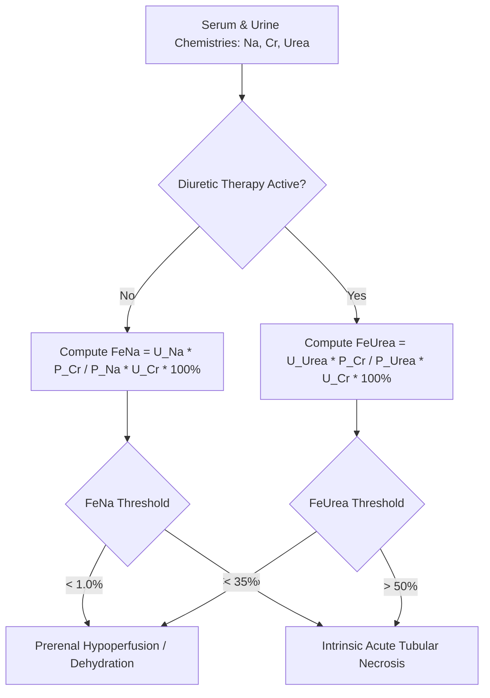

# Renal Fractional Excretion of Sodium (FeNa) & Urea Skill

[](LICENSE)
[](https://www.python.org/)
[](https://openclaw.org/)
[](https://alphapark.ai/)
[](https://modelcontextprotocol.io/)

Renal Fractional Excretion of Sodium (FeNa) & Urea (FeUrea) Quantitative Evaluator. Differentiates systemic hypovolemia from intrinsic tubular injury with diuretic compensation.



## Features
- **Zero PIP Dependencies**: Implemented strictly with Python Standard Library (`math`, `json`, `sys`, `typing`).
- **Diuretic Compensation**: Automatically switches to FeUrea when diuretics confound urinary sodium handling.
- **Precision Nephrology**: Quantitative clearance formulas matching clinical nephrology guidelines.
- **Dual Architecture**: Native Python import and Model Context Protocol (MCP) JSON-RPC 2.0 stdio server.

## Quickstart
```bash
python example_usage.py
```

## License
Apache-2.0
